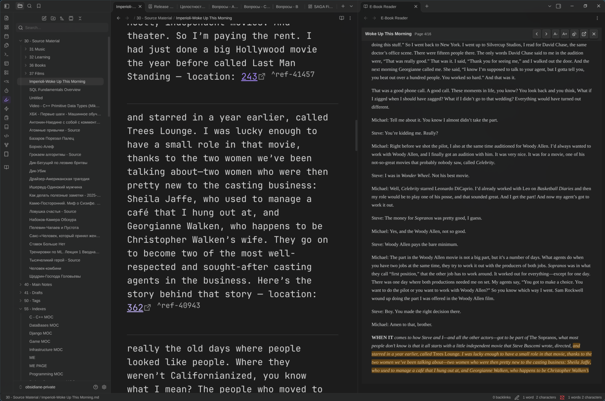

# Kindle Calibre Sync

Automatic bridge for syncing Kindle highlights and notes directly into Calibre and Obsidian.



## Quick Start

1. **Install the Obsidian plugin**:
   - Open Obsidian **Settings** → **Community plugins** → **Browse**, search for **Kindle Calibre Sync**, install, and enable it.
   - *(While community directory review is pending, you can also install via [BRAT](https://github.com/TfTHacker/obsidian42-brat) by adding `divohub/kindle-calibre-sync`.)*
2. **Prepare Calibre & Python backend**:
   - Make sure **Calibre** (with your books added) and **Python 3.9+** are installed.
   - Clone this repository for the Python sync script and install dependencies:
     ```bash
     git clone https://github.com/divohub/kindle-calibre-sync.git
     cd kindle-calibre-sync
     pip install -r requirements.txt
     ```
3. **Configure paths**:
   - Set your vault and Calibre paths in `config.json`.
   - Open **Settings → Kindle Calibre Sync** in Obsidian and verify **Sync script path** (path to `kindle_sync.py`) and **Calibre library path**.
4. **Sync & Read**:
   - Plug in your Kindle via USB and click the book icon in the left ribbon (or run the command **Sync highlights with Calibre**).
   - Click any `[location](calibre://...)` link in your generated book notes to open the EPUB side-by-side at the exact quote.

---

## Features

1. **Auto-detect Kindle via USB**:
   - Scans mount points (`/run/media/$USER/*`, `/media/*`, `/Volumes/*`, Windows drives).
   - Automatically locates `documents/My Clippings.txt`.
   - In `--watch` mode, continuously listens for Kindle USB connections and syncs without manual intervention.
2. **Native Calibre Injection**:
   - Matches books in Calibre's `metadata.db` by title and author.
   - Unpacks EPUB files and calculates exact fragment coordinates (`EPUB CFI`).
   - Injects native highlights and user notes into Calibre's `annotations` table. When opening the book in Calibre Viewer, all highlights appear in yellow.
3. **Obsidian Notes Generation & Deep-Linking**:
   - Format 100% compatible with `obsidian-kindle-plugin` (frontmatter, `^ref-XXXXX`, stored in `30 - Source Material`).
   - Converts empty location links `location: [482]()` into clickable deep-links `location: [482](calibre://view-book/...)`.
   - Clicking a location number opens the embedded e-book reader directly in Obsidian alongside the note at the exact highlighted sentence.
   - External Calibre Viewer remains available as an optional one-click button in the reader toolbar.
   - Duplicate protection: existing notes are preserved and cleanly updated with only new quotes.
4. **Automatic EPUB Conversion**:
   - If a book in Calibre is only available in `.fb2` or `.azw3`, the bridge automatically converts it to `.epub` via `ebook-convert` and indexes all coordinates seamlessly.

---

## System Requirements

1. Ensure Python 3.9+ and Calibre are installed:
```bash
sudo pacman -S python calibre   # Arch Linux
# or: sudo apt install python3 calibre  # Ubuntu/Debian
```

2. Install Python dependencies (`lxml` for EPUB CFI parsing):
```bash
pip install -r requirements.txt
```

---

## Configuration (`config.json`)

The `config.json` file is created automatically with the following parameters:

```json
{
  "vault_path": "/home/divo/Documents/obsidiane-private",
  "highlights_folder": "30 - Source Material",
  "calibre_library_path": "/home/divo/Calibre Library",
  "calibre_library_id": "Calibre_Library",
  "kindle_mount_patterns": [
    "/run/media/*/*",
    "/media/*/*",
    "/Volumes/*"
  ],
  "clippings_file_relpath": "documents/My Clippings.txt",
  "clippings_fallback_path": "/home/divo/My Clippings.txt",
  "inject_calibre_annotations": true
}
```

---

## Usage

### 1. One-time Sync (with USB auto-detect / fallback file)
```bash
python3 kindle_sync.py
```

### 2. Dry-run Mode (simulation without database/file writes)
```bash
python3 kindle_sync.py --dry-run
```

### 3. Sync a Specific Book
```bash
python3 kindle_sync.py --book "Ubik"
```

### 4. Background Watcher Mode (Daemon)
Polls for Kindle USB connection every 5 seconds and triggers sync automatically:
```bash
python3 kindle_sync.py --watch
```

---

## Project Structure

- `kindle_sync.py` — Main orchestrator and CLI.
- `clippings_parser.py` — Parser for `My Clippings.txt` (supports RU and EN locales, merges user notes with highlights).
- `calibre_adapter.py` — Calibre book matcher, EPUB CFI calculator, SQLite annotations injector, deep-link builder.
- `obsidian_exporter.py` — Markdown note generator/updater matching `obsidian-kindle-plugin` format.
- `config.json` — Paths and settings.
- `obsidian-plugin/` — Source code for the native Obsidian plugin.

---

## Native Obsidian Plugin (`kindle-calibre-sync`)

The plugin is located in `obsidian-plugin/` and installed to `.obsidian/plugins/kindle-calibre-sync/`.

1. **Enable Plugin**:
   - Open Obsidian **Settings** $\rightarrow$ **Community plugins** $\rightarrow$ click **Reload plugins**.
   - Enable **Kindle Calibre Sync & Reader**.
2. **Ribbon Sync Button**:
   - A `book-open` icon is available on the left ribbon. Clicking it triggers sync with status notices.
3. **Embedded Side-by-Side Reader**:
   - Clicking any `[location](calibre://...)` link opens a side pane with the built-in EPUB reader (`ePub.js`).
   - Automatically navigates to the exact quote and highlights it in warm amber.
   - All quotes throughout the book are highlighted in soft yellow.
   - Supports light, dark, and sepia themes, font size scaling (`A-` / `A+`), and keyboard arrow navigation.
   - Click the external link icon in the reader toolbar to open Calibre Viewer if needed.
